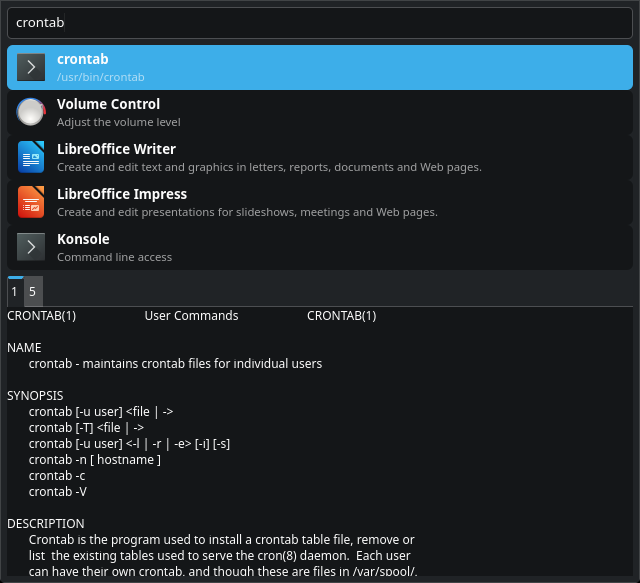

# sysdeck

[](https://xn--gckvb8fzb.com/segv/)



_sysdeck_ is a command center for Linux and the BSDs.

[](https://xn--gckvb8fzb.com/contact/)

_sysdeck_ is supposed to be bound to a hotkey, which will activate it, allowing
you to type in something. It then shows what matches across various areas,
including:

- The applications installed on your system
- The command line executables in your paths
- Arithmetic operations
- Sway windows
- etc.

_sysdeck_ keeps track of the things you search for and use, and optimizes its
suggestions based on that data.

It can run applications, opens executables it in your favorite terminal, show
the processes that are running, allowing you to focus them, and it shows manual
pages for programs that have them.

_sysdeck_ also replaces `dmenu` with its integrated `--dmenu` mode:

```sh
ls | sysdeck --dmenu | xargs -I {} echo "I selected {}"
```

## Installation

_sysdeck_ is built from source. It needs Zig 0.16 or newer and the GTK4, GLib
and SQLite development files:

| System  | Packages                                     |
| ------- | -------------------------------------------- |
| Fedora  | `gtk4-devel glib2-devel sqlite-devel`        |
| Debian  | `libgtk-4-dev libglib2.0-dev libsqlite3-dev` |
| Arch    | `gtk4 glib2 sqlite`                          |
| Alpine  | `gtk4.0-dev glib-dev sqlite-dev`             |
| Gentoo  | `gui-libs/gtk:4 dev-libs/glib dev-db/sqlite` |
| Void    | `gtk4-devel glib-devel sqlite-devel`         |
| FreeBSD | `gtk4 glib sqlite3`                          |
| OpenBSD | `gtk+4 glib2 sqlite3`                        |
| NetBSD  | `gtk4 glib2 sqlite3`                         |

```sh
zig build -Doptimize=ReleaseFast --prefix ~/.local
```

That writes `~/.local/bin/sysdeck`. You can set `--prefix /usr/local` for a
system wide install instead.

## Configuration

First, bind _sysdeck_ to a key in your window manager. On Sway for example like
this:

```
bindsym $mod+space exec sysdeck
```

**Note:** _sysdeck_ does not position its own window (because it can't). If your
compositor puts it somewhere you don't like, tell the compositor where to put
it:

```
for_window [app_id = "sysdeck"] {
  floating enable
  move up 300 px
}
```

## Usage

Type to search and use the arrow keys to move through the list. Press _Return_
to accept the selected entry or _Escape_ to close the popup. The popup also
closes when it loses focus.

Entries that have a manual page show it underneath. Press _Alt_ to show an
entry's context menu (if it has one), press the number of the right side in the
context menu to run the specific command.

Switch through the manual pages with the function keys, so _Alt+F1_ shows
`man 1`, _Alt+F5_ shows `man 5`, if those exist (visible via the tabs). Both
shortcuts are defaults you can change, see `[keys]` below.

### dmenu

Use the dmenu mode with the `--dmenu` flag:

```sh
sysdeck --dmenu < list.txt
```

_sysdeck_ exits with `0` when you picked something and with `1` when you pressed
_Escape_.

### Options

| Option            | Description                               |
| ----------------- | ----------------------------------------- |
| `--dmenu`         | Read the list from standard input         |
| `-p`, `--prompt`  | Set the placeholder shown in the text box |
| `-l`, `--lines`   | Show at most this many rows               |
| `-h`, `--help`    | Print the help and exit                   |
| `-v`, `--version` | Print the version and exit                |

## Configuration

Configuration is optional and read from `$XDG_CONFIG_HOME/sysdeck/config.toml`,
or from `$HOME/.config/sysdeck/config.toml` when `XDG_CONFIG_HOME` is unset. A
documented example can be found in [`config.example.toml`](config.example.toml).

## Database

The main database in which _sysdeck_ stores indexes is in
`$XDG_DATA_HOME/sysdeck/sysdeck.db`. An index is rebuilt in the background when
it gets older than `max_age_minutes`, and while that happens queries go against
the (maybe) outdated index.

## License

Copyright © 2026 [マリウス](https://xn--gckvb8fzb.com)

_sysdeck_ is released under Version 1.1 of the
[SEGV License](https://xn--gckvb8fzb.com/segv/), whose full text is included in
the [LICENSE](LICENSE) file. Go read it, there will be a test on it on Monday.
